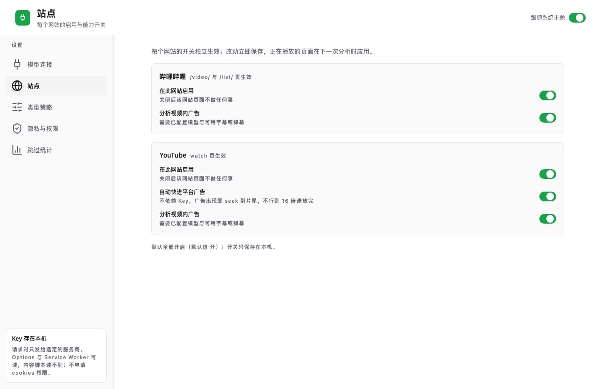

# Skip Video Ad

[](https://github.com/bungabungawoda/skip-ad/actions/workflows/test.yml)
[](https://github.com/bungabungawoda/skip-ad/actions/workflows/build.yml)
[](LICENSE)

一个 Chrome 扩展，帮你在哔哩哔哩和 YouTube 上看视频时跳过广告：

- YouTube 的片头广告不用配置，自动快进到结尾。
- 视频创作者自己念的推广口播，配置一次 AI 服务后，播放到时自动跳过。

## 安装

### 一句话装好

不想自己敲命令，可以把下面这句话发给你常用的编程助手（Codex、Claude Code 等）：

> 按 https://github.com/bungabungawoda/skip-ad 里的安装技能，帮我装好扩展。

助手会读取仓库里的 [安装技能](skills/install-skip-ad/SKILL.md)，先问你有没有自己的模型 API Key：有就直接用你的 Key；没有会先说明 magpie 是什么、有什么风险，得到你同意后才安装。之后它会拉取代码并构建。最后你只需要在 Chrome 的扩展页点「加载已解压的扩展程序」，选择 `output/chrome-mv3`。

### 手动安装

需要 Node 22.13 以上和 Chrome 120 以上。在项目目录里运行：

```bash
npm install
npm run build
```

然后打开 `chrome://extensions`，开启右上角的「开发者模式」，点「加载已解压的扩展程序」，选择项目里的 `output/chrome-mv3` 文件夹。第一次安装会自动打开设置页。

## 快速上手

### 确认扩展在哪些网站工作

设置页左侧点「站点」。哔哩哔哩有启用和分析视频内广告两个开关；YouTube 还有自动快进平台广告的开关。默认都开着，绿色表示开启，灰色表示关闭，改动立刻保存。



### 看视频时怎么跳过广告

**YouTube 片头广告：不用配置，自动跳。** 广告出现时扩展直接跳到结尾；跳不过去就用很快的速度静音播完。

**视频里的推广口播：先配一次 AI 服务，之后自动跳。** 扩展在进度条上把广告段画成色块（YouTube 用蓝色，哔哩哔哩按片段类型用不同颜色），播放到开头时自动跳过去，右上角提示「已跳过」，5 秒内可以撤销。撤销会回到你跳转前的位置，并且本次播放不再自动跳这一段。你也可以把鼠标移到色块上，点带播放图标的按钮自己跳。

色块只是标记，不影响拖动进度条。想看这段广告，照常拖进去就行。

下面这段演示展示了自动跳过和撤销的过程：

https://github.com/user-attachments/assets/38183045-32ac-4d5e-b70f-58623ebd14e2

工具栏角标告诉你扩展现在在做什么：

| 角标 | 含义 |
|---|---|
| `…` | 正在找广告 |
| `AD 3` | 找到了 3 段 |
| `AD 0` | 看完，没发现广告 |
| `∅` | 没读到字幕和弹幕 |
| `!` | 出错了，去设置页看看 |

## 配置模型

视频里的推广口播需要你自己的模型 Key。扩展作者不收集 Key，也不会把 Key 发到自己的服务器。

1. 在设置页「模型连接」里选一家服务商，API 地址会自动填好；也可以直接把服务商地址粘到「API 地址」，扩展会自动识别。
2. 粘贴这家给你的 Key，点「连接」。
3. 扩展会挑一个便宜、快的模型并验证，成功后显示「已连接 服务商 · 模型」。

Key 只保存在你这台电脑的浏览器里；发起请求时，Key 会发给你选定的服务商。想用自建服务，把地址粘到「API 地址」；认不出已知服务商时会切到「自定义端点」，再填模型名即可。

地址框默认显示当前服务商的接口地址，连接成功后也会继续显示实际使用的地址。粘贴时省略 `https://` 也能识别；本机网关可以填 `127.0.0.1:端口`，扩展会按本机 HTTP 地址处理。

设置页、弹窗和播放器提示会自动跟随浏览器界面语言：中文环境显示简体中文，其他语言显示英文。

如果你有 Jev（TypeSafe）或 Google 决策模型的 API Key，可以在同一页填写「决策模型」的接口、Key 和模型名。目前支持 Google Gemini 和 TypeSafe 两种请求格式，扩展按接口地址自动识别。TypeSafe 填 `https://api.typesafe.ai/v1/systemone`，模型名填 `jev-latest`，Key 填 TypeSafe 给你的 Key。填了会优先用它；请求失败时本次分析会停止，不会自动改用上面的服务。

### 用 magpie 省掉 API Key

不想申请模型 API Key，可以先在本机运行 [magpie](https://github.com/yetone/magpie)。它提供一个本地接口，把扩展的请求转给你在 magpie 里配置的模型或已经登录的账号，Key 可以留空。

1. 启动 magpie，在它的界面里添加一个可用的模型。
2. 回到扩展设置页，把「API 地址」填成 `http://127.0.0.1:3425/v1`，Key 留空。
3. 模型名填 `magpie models` 打印的完整 id，例如 `deepseek/deepseek-v4-pro` 或 `group/xxx`，点「连接」。

扩展只连本机地址，不经过扩展作者的服务器。请求最终发给谁，取决于你在 magpie 里配置的服务商或本地模型。

magpie 是第三方软件，会读取本机 AI 应用已经登录的账号来转发请求。用它给别的程序发请求，可能不符合服务商的使用条款，存在被限流或封号的风险，装之前请自己确认。

## 权限与隐私

扩展申请本地存储、哔哩哔哩和 YouTube 视频页访问权限，以及内置服务商的 AI 接口地址。第一次连接自定义服务地址时会单独询问。不读取 Cookie，不需要你的登录态。

分析时，扩展会把内容直接发给你选定的模型服务商：B 站发视频标题、UP 主、简介、字幕和弹幕样本；YouTube 发视频 ID、时长和字幕。你的账号信息、浏览器历史不会发送。服务商如何使用这些数据，受它自己的隐私政策约束。

完整的隐私政策、数据使用说明和同意方式见 [PRIVACY.md](PRIVACY.md)。

## 开发与发布

常用命令：

```bash
npm test
npm run lint
npm run typecheck
npm run build
```

生成 Chrome Web Store 发布素材：

```bash
npm run store:assets
```

这个命令会构建扩展、生成商店规格的截图和促销图，并输出到 `release/`。脚本默认查找 Chrome for Testing；找不到时用 `CHROME_PATH` 指定浏览器可执行文件。


## 许可证

本项目代码使用 [MIT License](LICENSE)。第三方组件继续适用各自的许可证。
